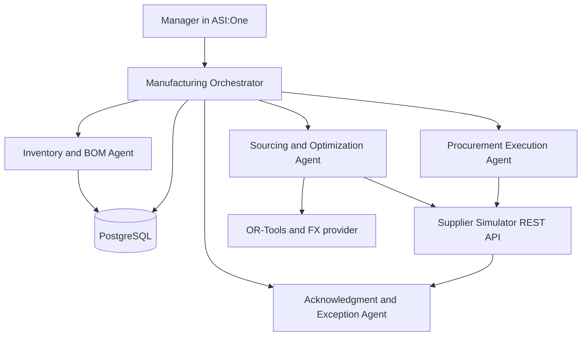

# SupplyMesh AI

SupplyMesh AI is a deterministic, multi-agent procurement orchestrator for manufacturers. A
manager describes a demand in ASI:One; five company-side agents protect existing inventory,
calculate BOM shortages, collect supplier REST quotations, optimize sourcing, execute approved
X12 purchase orders, and resolve supplier acknowledgment conflicts.

This repository is an implementation in progress. The local deterministic workflow is tested,
but the project is **not submission-complete**: Agentverse profiles, a deployed ASI:One
conversation, its shared URL, and the demo video require deployment credentials and manual
verification. See [verification status](docs/verification.md).

## Why this is agentic

The Orchestrator owns a durable LangGraph state machine and delegates typed work to four
specialists. Numeric truth remains in small Python services: BOM math, inventory allocation,
OR-Tools optimization, money, approval hashes, X12, and discrepancy impact. An LLM may extract
intent or explain those results, but cannot alter them or trigger side effects without validated
human approval.



Suppliers are external REST endpoints simulated by one FastAPI service. They are deliberately
**not agents**. There is no React or other custom frontend; ASI:One is the intended primary UI.

## Agents

| Agent | Deterministic responsibility |
|---|---|
| Manufacturing Orchestrator | ACP entry point, workflow transitions, approvals, status |
| Inventory and BOM | Effective BOM, protected reservations, available-to-promise, shortage |
| Sourcing and Optimization | Concurrent RFQs, validation, FX normalization, OR-Tools plans |
| Procurement Execution | Approval revalidation, X12 850/860, idempotent supplier calls, polling |
| Acknowledgment and Exception | X12 855/865 parsing, materiality, impact, exception actions |

Each identity requires its own environment-only seed. The host rejects missing or duplicate seeds.

## Workflow

1. Validate manufacturing demand.
2. Expand the generic BOM and preserve existing/higher-priority reservations.
3. Calculate shortages from on-hand, confirmed inbound, reservations, and safety stock.
4. Request quotes concurrently from three configuration-driven supplier routes.
5. Produce cheapest, fastest, balanced, risk-aware, and split plans with OR-Tools.
6. Pause for plan approval, then pause separately before sending purchase orders.
7. Persist a pending side-effect record, send idempotent X12 850 POs, and persist the result.
8. Poll for X12 855 acknowledgments and compare every line deterministically.
9. Complete exact matches. For material differences, pause for accept, counter, switch, split,
   or cancel.
10. A human-approved counterproposal follows the same durable side-effect sequence for X12 860
    and processes the supplier's X12 865 response.

LangGraph checkpoints live in PostgreSQL. A verified restart test closes and reconstructs the
graph/checkpointer at both approval pauses before completing the same workflow thread.

## Technology

- Python 3.11–3.13, Pydantic 2, FastAPI, HTTPX
- uAgents 0.25.5 and Agent Chat Protocol 0.3.0
- LangGraph with `langgraph-checkpoint-postgres`
- PostgreSQL 17, SQLAlchemy 2, Alembic
- Google OR-Tools CP-SAT
- pytest, Ruff, mypy, uv
- Optional Sentry; failures never block the workflow
- Frankfurter v2 as a no-key FX provider with PostgreSQL cache/fallback

## Local setup

Requirements: Python 3.11+, [uv](https://docs.astral.sh/uv/), and PostgreSQL 17. Docker Compose is
provided but not required for tests.

```bash
cp .env.example .env
uv sync --frozen
uv run alembic upgrade head
uv run python scripts/setup_checkpoints.py
uv run python scripts/seed_demo.py
uv run pytest
```

Populate `DATABASE_URL`, the two supplier keys, and all five unique agent seeds before starting
the full services. Never reuse the example database password outside local development.

```bash
uvicorn apps.supplier_simulator.main:app --host 0.0.0.0 --port 8001
python -m apps.agent_host.main
```

With Docker running:

```bash
docker compose up --build
```

The agent host exposes the uAgents/Bureau endpoint on port 8000. The standalone diagnostic FastAPI
app in `apps.agent_host.health` provides `/health` and database-aware `/ready` when run separately.
The supplier simulator exposes `/health`, `/ready`, supplier endpoints, and non-production admin
scenario controls.

## Environment variables

`.env.example` is authoritative. Important groups are:

- Runtime: `APP_ENV`, `LOG_LEVEL`, `DATABASE_URL`
- Fetch.ai: `ASI_ONE_API_KEY`, `ASI_ONE_MODEL`, `AGENTVERSE_API_KEY`
- Identity: one `*_AGENT_SEED` for each of the five company agents
- Supplier boundary: `SUPPLIER_SIMULATOR_BASE_URL`, `SUPPLIER_API_KEY`,
  `SUPPLIER_ADMIN_API_KEY`
- Reliability: HTTP retry/timeouts, quote threshold, acknowledgment polling policy
- FX: `FX_PROVIDER_URL`, `FX_CACHE_TTL_SECONDS`
- Optional observability: `SENTRY_DSN` and sample rates

Do not commit `.env`, private keys, seed files, or Agentverse state. The `.gitignore` and
`.dockerignore` cover the expected local forms.

## Database and seed data

Alembic owns SupplyMesh tables. LangGraph owns its `checkpoint*` tables through
`PostgresSaver.setup()`; Alembic intentionally excludes only those framework-owned tables from
drift checks. Migrations and checkpoint setup are both included in `make migrate`.

`make seed` idempotently loads UrbanX as demo data: a generic product/BOM schema, ten motorcycle
components, a protected 100-unit quarterly demand, inventory, safety stock, and committed
reservations. Motorcycle facts are data, not domain code.

## Tests and quality

```bash
make lint
make typecheck
make test
make check
DATABASE_URL=postgresql+psycopg://... uv run alembic check
```

The suite contains unit, supplier-contract, workflow, and local end-to-end tests. It covers exact
and conflicting acknowledgments, duplicate external calls, partial suppliers, all-supplier
failure, stale approvals, FX fallback, controlled recovery, and PostgreSQL checkpoint resumption.
The Fetch connectivity integration test additionally drives a demand-card reply through registered
Orchestrator and Inventory uAgent protocol handlers, verifies wire serialization/correlation, and
asserts the returned assessment card against protected inventory. Specialist integration tests
exercise typed sourcing, plan, PO, acknowledgment, counterproposal, change-response, status, and
bounded-failure messages. CI repeats formatting, linting, strict
agent/domain/persistence/protocol/service typing, tests, migrations, and drift checks.

## Supplier API and demo scenarios

Supplier commands require `X-API-Key`, `Idempotency-Key`, and `X-Correlation-ID`. Supported routes:

- `GET /api/v1/suppliers/{id}/capacity`
- `POST /api/v1/suppliers/{id}/rfqs`
- `POST/GET /api/v1/suppliers/{id}/purchase-orders[/transaction]`
- `POST/GET /api/v1/suppliers/{id}/change-orders[/transaction]`

Non-production scenario routes use the separate admin key:

```bash
curl -X POST -H "X-API-Key: $SUPPLIER_ADMIN_API_KEY" \
  http://localhost:8001/api/v1/demo/scenario/first_call_timeout_then_success
```

Available scenarios include happy path, price/quantity/delivery and multi-conflict cases,
counter rejection, first-call recovery, supplier unavailability, and malformed acknowledgment.
Admin routes return 404 in production mode.

## ASI:One and Agentverse

The Orchestrator publishes the official Agent Chat Protocol manifest and emits Interactive Card
metadata with a text fallback. Card payloads are strict, versioned, and limited to 64 KB. Current
local card builders cover intake, plans, approval, exceptions, completion, and agent activity. The
implemented connectivity slice accepts the structured demand-card reply, persists its workflow and
demand, exchanges a typed request/result with the Inventory Agent, and returns the correlated
inventory card. All other specialists now publish typed transport handlers backed by the real REST,
FX, approval, idempotency-journal, EDI, polling, and comparison services. Orchestrator routing from
the inventory result through those later stages is the next implementation step.

Live deployment checklist:

1. Set five unique seeds and Fetch.ai credentials in the deployment secret manager.
2. Set `PUBLISH_AGENT_DETAILS=true` and deploy stable HTTPS services/PostgreSQL.
3. Confirm all five Agentverse profiles and the Orchestrator's ACP 0.3.0 manifest.
4. Test direct mention, discovery/planner routing, structured card replies, and natural-language
   replies in ASI:One.
5. Complete one full conversation, publish its shared URL, and record the demo.

- Agentverse profile URLs: **pending deployment/manual verification**
- ASI:One shared-chat URL: **pending deployment/manual verification**
- Demo video: **pending recording after live verification**

## Demo prompt

> We received a rush order for 75 UrbanX motorcycles required by December 1. Protect inventory
> already reserved for existing orders, determine any shortages, get supplier quotations, and
> recommend a procurement plan.

The local e2e suite exercises both an exact-acknowledgment version and a price-conflict version
that reaches an accepted counterproposal. It does not substitute for the required live ASI:One
conversation.

## X12 scope

This is an educational hackathon subset, **not a certified production EDI translator**. It
generates and validates the required envelope and business segments for 850, 855, 860, and 865;
checks transaction/control counts; preserves raw documents and unknown segments; and parses the
fields used for PO/version/currency/line matching. Production VAN connectivity and full X12
coverage are non-goals.

## Reliability, audit, and security

- Approval records bind target ID, version, actor, time, and canonical SHA-256 payload hash.
- Stable idempotency keys prevent duplicate RFQs, POs, and change orders.
- A durable journal commits `PENDING` before and `SUCCEEDED` after external commands.
- Retries are bounded and limited to safe/idempotent calls; sourcing can continue at its quote
  threshold and never invents a plan.
- Duplicate/stale acknowledgments quarantine; invalid EDI becomes recoverable workflow state.
- Raw credentials, seeds, authorization headers, and internal stack traces are never card/log data.
- Supplier URLs come from configuration; inbound bodies are Pydantic-validated.
- Sentry is optional and fails open. Structured local logging remains available.

Future production work includes ERP/WMS connectors, certified EDI translation/VAN transport,
supplier master-data governance, encryption/key rotation, and deployment-specific rate limiting.

## Architecture decisions

- [ADR 0001: current Fetch.ai chat/card APIs](docs/adr/0001-fetch-agent-chat-protocol.md)
- [ADR 0002: LangGraph PostgreSQL checkpoint ownership](docs/adr/0002-langgraph-postgres-checkpoints.md)
- [ADR 0003: Frankfurter v2 FX provider](docs/adr/0003-frankfurter-fx.md)
- [ADR 0004: uAgents wire boundary for Pydantic 2 contracts](docs/adr/0004-uagents-pydantic-wire-boundary.md)
